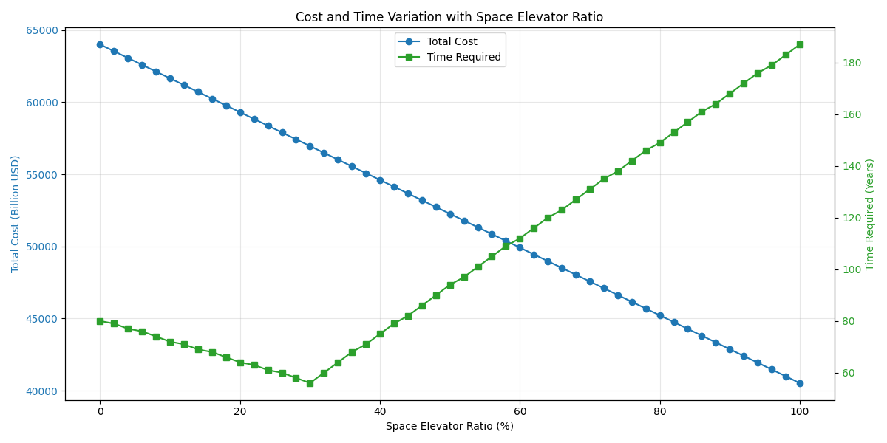

# 2026 MCM Problem B: Creating a Moon Colony Using a Space Elevator System

[](LICENSE)
[](https://www.python.org/)
[](https://lyingloong.github.io/2026-MCM-b-solution/)

**Team 2622082** · 2026 Mathematical Contest in Modeling (MCM), Problem B · 🏅 Honorable Mention

📄 [Paper (PDF)](https://lyingloong.github.io/2026-MCM-b-solution/paper2622082.pdf) ·
🏅 [Certificate (PDF)](https://lyingloong.github.io/2026-MCM-b-solution/certificate2622082.pdf) ·
🌐 [Project page](https://lyingloong.github.io/2026-MCM-b-solution/)



## Overview

The task is to move a large amount of material to the Moon (`1e8` tonnes in the
baseline) and to decide how much of it should travel by space elevator versus
conventional rockets. This repository contains the full model, the analysis
scripts and every figure used in our paper:

- **Three transport scenarios** — space elevator only, rockets only, and a
  hybrid fleet — compared on completion time, total cost and annual capacity.
- **Problem 2** adds a reliability / availability model (Weibull wind
  distribution, Monte-Carlo simulation, reusable-rocket depreciation) and a
  sensitivity study of the optimal mix.
- **Problem 3** handles the extra material demand and is solved both per year
  and per month (`MONTH_MODE` in `src/constants.py`).
- **Problem 4** quantifies the environmental impact of the different
  architectures from propellant consumption through to emission-weighted
  impact, including a hybrid-ratio sweep.
- **Sensitivity analyses** over three-dimensional parameter grids show how
  robust the recommendations are.

## Team

| Name | GitHub |
| --- | --- |
| Hao Wang | [@lyingloong](https://github.com/lyingloong) |
| Renhao Li | [@stdlibstring](https://github.com/stdlibstring) |
| Wenchao Yu | [@ANT181603](https://github.com/ANT181603) |

## Repository layout

```text
data/          Reference datasets (see data/README.md)
figures/       Figures used in the paper, grouped by analysis
src/           Model, plotting and sensitivity code
  main_model.py                  Scenario model for Problems 1-3
  constants.py                   All model parameters (MONTH_MODE switch)
  plotter.py                     Core figures
  p2_sensitivity_analysis.py     Problem 2 reliability model
  p3_extra_plots.py              Problem 3 additional figures
  p4_pollution_analysis.py       Problem 4 environmental impact
  sensitivity_analysis_v1.py     Basic 3D sensitivity analysis
  sensitivity_analysis_v2.py     Enhanced 3D sensitivity analysis
mcm_problem_b.txt                  Problem statement
run_main.sh                        One-shot reproduction script
requirements.txt                   Python dependencies
```

## Getting started

Requires Python 3.8+ (tested with Python 3.12).

```bash
git clone https://github.com/lyingloong/2026-MCM-b-solution.git
cd 2026-MCM-b-solution
python -m venv .venv
source .venv/bin/activate        # Windows: .venv\Scripts\activate
pip install -r requirements.txt
bash run_main.sh
```

`run_main.sh` runs every step in order and writes all generated data and
figures to `./results/`, which is git-ignored on purpose. The figures committed
under `./figures/` are the exact versions used in the paper.

### Running individual steps

| Command | Output |
| --- | --- |
| `python -m src.main_model` | `results/problem_{1,2,3}/*.txt` |
| `python -m src.plotter` | Core figures under `results/problem_*` |
| `python -m src.p3_extra_plots` | Six extra Problem 3 figures |
| `python -m src.p2_sensitivity_analysis` | `results/p2_sensitivity_analysis/` |
| `python -m src.p4_pollution_analysis` | `results/p4_pollution_analysis/` |
| `python -m src.sensitivity_analysis_v2` | `results/sensitivity_analysis/` + 3D surfaces |

Each step depends only on the outputs of the steps above it, so the order in
`run_main.sh` is the intended one.

## Data

| File | Description |
| --- | --- |
| `data/Global_Space_Exploration_Dataset.csv` | Raw Kaggle dataset (2000-2025 global space launches). |
| `data/space_launch_data_2000_2025.csv` | Processed extract derived from the raw dataset. |

The model itself is parameterised by `src/constants.py` rather than reading the
CSVs at runtime; the data is included for provenance. See
[`data/README.md`](data/README.md) for the source link and licensing notes.

## License

Released under the [MIT License](LICENSE). The Kaggle dataset in `data/`
remains subject to its original license.

## Acknowledgements

The launch dataset comes from
[atharvasoundankar on Kaggle](https://www.kaggle.com/datasets/atharvasoundankar/global-space-exploration-dataset-2000-2025).
MCM/ICM is organized by [COMAP](https://www.comap.com/).
